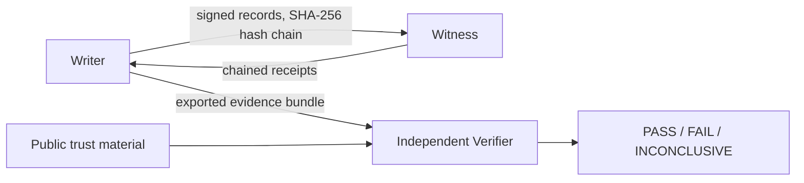

# CASF — Cryptographic Audit & Signing Framework

An embeddable Python mechanism for producing and independently checking
audit histories, with conditional rollback detection using independently
retained witness state.

**Status:** development release candidate, version `0.1.0.dev0`.
Implementation and evaluation artifacts are recorded, including the adversarial
detection matrix, Linux replication, and twenty remote witness benchmark runs.
Release approval remains separate from implementation progress; see the
[release checklist](docs/release/checklist-v0.1.md) for open requirements. The governing
design document is CASF SPEC 001; the claim discipline in SPEC §29
applies to all public descriptions of this project.

## How it works

A writer appends records signed with Ed25519 and linked by a domain separated
SHA-256 hash chain (RFC 8785 JCS canonical encoding). A stateful,
independently operated witness accepts only valid chain extensions and
issues chained receipts. Anyone holding an exported evidence bundle and
the public trust material can check integrity and anchored evidence offline. Online verification also
consults the witness. The modes return separate typed
results (PASS / FAIL / INCONCLUSIVE). Epoch based key rotation and
terminal revocation are supported.

## The problem
Ordinary stored logs can be edited, reordered, or restored to an older
valid snapshot without reliable evidence in the restored copy itself.
CASF addresses integrity evidence and conditional detection of missing
history. It does not make storage physically immutable, and successful
verification is not proof that every real world event was recorded.

## Evaluation results

All benchmark artifacts and reports are in `benchmarks/results/`:

- **Adversarial detection matrix** (`detection-v1/`): rollback, fork,
  truncation, and key theft scenarios against the verifier, confirming
  both what is detected and the declared detection boundaries (T18, T20,
  T21 in `research/limitations.md`).
- **Second machine Linux matrix** (`linux-matrix-v2/`): replication of
  the benchmark matrix on independent hardware.
- **Remote witness benchmark** (`wide-area-v3/`, 20 completed runs, 10 per
  configuration): writer on a local Linux host, witness on an AWS
  Lightsail instance in Frankfurt (eu-central-1), 10,000 records per
  run. Headline numbers (bootstrap over runs, 95% intervals):

  | Configuration | append p50 | records/s | witness p50 | verify (10k records) |
  |---|---:|---:|---:|---:|
  | batch 128 | 0.80 ms | ~1273 | ~1185 ms | ~5.6 s |
  | batch 16 | 0.46 ms | ~1462 | ~671 ms | ~3.1 s |

  The records/s column measures append operation time, not total elapsed
  throughput including witness calls. These describe one network path only (one writer, one witness region);
  no general claim about other network paths is made. Full method notes and raw rows are
  in [the remote witness report](benchmarks/results/wide-area-v3/report.md).
- **Research findings** (RQ1–RQ4, H1–H3): local vs. independently
  witnessed checkpoints, with declared limitations in
  [`research/limitations.md`](research/limitations.md).

## Explicit limits (read before using)
- Detection claims are conditional on assumptions A1–A6 in the specification (SPEC §6)
- A compromised writer can sign false new events; the witnessed prefix constrains what can match retained history
- The unwitnessed suffix after the last accepted checkpoint carries exposure (SPEC §7)
- The witness sees full record payloads in v1; minimize sensitive fields
- CASF provides no legal nonrepudiation, no completeness guarantee for events never submitted, and no confidentiality guarantee

## Repository layout
| Path | Content |
|---|---|
| `docs/specification/` | CASF SPEC 001 (governing design document) + D01 source reconciliation |
| `docs/adr/` | Architecture decision records |
| `docs/01..05` | Historical design context (superseded by SPEC 001) |
| `src/casf/` | casf-v1 implementation (writer, witness, verifier, crypto, storage, CLI) |
| `vectors/v1/` | Frozen conformance vectors |
| `tests/` | Unit / property / conformance / integration / adversarial suites |
| `benchmarks/` | Workloads, attack harnesses, run manifests, and raw results |
| `research/` | Research protocol, results, limitations |

## Claim discipline
Public descriptions of this project must follow SPEC §29: say
"cryptographically verifiable audit records with conditional rollback
detection using independently retained witness state." Do not say
"tamper-proof", "guaranteed complete", "forward secure", "globally
fork free", "compliant", "audited", or "novel cryptography" without
separate, specific evidence.

## License
Apache License 2.0. See [LICENSE](LICENSE).
