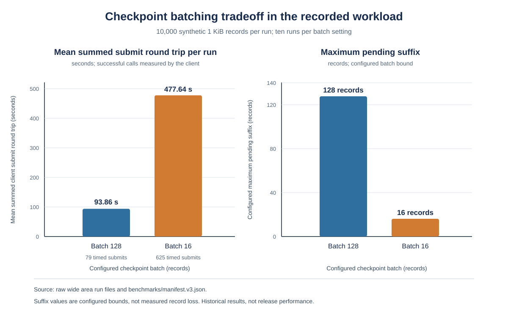

# Conditional Rollback Detection for Signed Audit Logs with an Independent Stateful Witness

**Hamdam Aynazarov**

ORCID: [0009-0009-0905-2628](https://orcid.org/0009-0009-0905-2628)

**Preprint. Not peer reviewed.**

### Abstract

Signed audit records can make changes to recorded history detectable, but a valid local history does not establish that the verifier has the latest history. This paper evaluates CASF, an experimental Python framework that links signed records with SHA 256 and uses an independently operated stateful witness to retain signed checkpoints. Ten declared detection scenarios matched their expected outcomes. A separate canonical H1 experiment found that a local signed history accepted an older valid snapshot in 10 of 10 runs. With a reachable witness but no retained client checkpoint, all ten checks were INCONCLUSIVE with WITNESS_AHEAD, rather than the predeclared FAIL; with a retained checkpoint, all ten returned FAIL with WITNESS_STATE_CONFLICT. Healthy and recovery controls passed. In a matched historical wide area workload, the mean successful client submit round trip per record was 9.39 ms at batch 128 and 47.76 ms at batch 16. The configured maximum pending suffix was 128 and 16 records respectively; these are bounds, not measured data loss, and the timing does not isolate witness side processing. A separate ten pair, three second loopback outage experiment supported canonical H3 within its tested scope: witnessed completion took longer and online freshness was inconclusive during unreachability, while offline integrity and online verification after recovery passed. A second machine reproduced selected historical counts and database sizes, but not latency. Two practical demonstrations distinguish CASF record verification from external PDF fingerprint comparison. CASF is an applied research prototype, not a new cryptographic construction, formal proof, or independent security audit.

**Keywords:** secure audit logging, rollback detection, witness, digital signatures, reproducible software research

### 1. Introduction

Audit evidence can be altered, truncated, or restored to an older valid state. Cryptographic signatures and hash chains help a verifier detect changes to the bytes and sequence it receives. They do not prove that the application recorded every relevant event or that a signed event describes reality. Nor does a valid local chain establish that it is the newest chain.

CASF explores one constrained response to rollback: a writer signs and links sequential records, while a separate stateful witness retains signed checkpoints for accepted extensions. A verifier can compare presented records with supplied checkpoint evidence, a checkpoint it retained earlier, or a fresh witness view. The assurance depends on which state the verifier holds, whether the witness is honest and reachable, and whether the relevant records have already been witnessed.

CASF uses established primitives: Ed25519 signatures, SHA 256 chaining, and deterministic JSON canonicalization based on RFC 8785 [6, 7, 8]. The contribution evaluated here is an implementation and a record of its conditional behavior, not a new cryptographic algorithm. The canonical questions are detection under independent witness state (RQ1), the costs added by witnessing (RQ2), the effects of batching and outages on unwitnessed exposure (RQ3), and operational burden and implementation complexity (RQ4). The earlier research protocol reused some labels for different topics, including historical RQ4 for reproducibility. Table 1 follows the definitions in SPEC §22 and identifies the historical labels separately.

### 1.1 Canonical research questions and hypotheses

This paper uses the canonical labels in Table 1 throughout. The project specification and research protocol used some of the same labels for different questions and hypotheses. Historical benchmark reports and experiment records retain their original labels; they are not silently reinterpreted here. The crosswalk identifies which source labels inform each canonical question and where the existing evidence is incomplete.

**Table 1. Canonical research questions and hypotheses, with historical label crosswalk.**

| Canonical label | Meaning and evidence boundary | Historical label mapping |
| --- | --- | --- |
| RQ1 | Which rollback and fork scenarios become detectable when a local signed chain gains independent witness state? | Ten detection scenarios and the separate H1 comparison inform this question. The proposed full comparison of three system configurations was not completed. |
| RQ2 | What latency, throughput, storage, and network cost does the witness add? | Selected local, Linux, and one path wide area measurements are available. There is no witness performance baseline, and the full SPEC §22 metric set was not measured. |
| RQ3 | How do checkpoint batching and outages change observed unwitnessed exposure? | The matched batching runs and controlled H3 outage inform this question. The pending suffix bound is not a measure of lost records. |
| RQ4 | Addressed descriptively through repository complexity and process proxies. Developer hours, cognitive load, usability, and total cost were not measured. | Historical protocol RQ4 asked about reproducibility. That historical question is distinct from canonical RQ4 and is not answered by this repository burden snapshot. |
| H1 | Tested; the outcomes depend on retained client state. See Section 5.2. | Canonical H1 follows SPEC §22. Historical protocol H1 predicted that every in model mutation would produce FAIL; that is a different claim. |
| H2 | Supported within one matched remote workload at the level of client measured successful submit round trip time per record. Server side processing was not isolated. See Section 5.6. | Canonical H2 follows SPEC §22. Historical protocol H2 named the T18, T20, and T21 nondetection cases; those cases inform canonical RQ1, not canonical H2. |
| H3 | Supported within the tested three second loopback outage scope. See Section 5.5. | Canonical H3 follows SPEC §22. Historical protocol H3 predicted linear verification cost, a separate exploratory result relevant to canonical RQ2. A fixed delay is not an outage experiment. |

The project specification also proposed comparing an unsigned chain, a locally signed chain, and an externally witnessed configuration. The completed studies do not fully implement that three arm design, and this paper does not imply that they do.

### 2. Related work

**Forward integrity and protected audit logs.** Schneier and Kelsey describe secure logging on an untrusted machine, with evolving authentication keys intended to protect entries created before the machine is compromised. Their design also addresses confidentiality of prior log entries [1]. The key idea relevant here is that later compromise should not grant an attacker the ability to alter earlier evidence without detection. CASF instead evaluates signed records and external checkpoint state. CASF does not claim forward secure signatures: an attacker who obtains the active writer key can create a false suffix after the latest witnessed checkpoint. A witness can constrain the history that matches a retained checkpoint, but it does not make future compromised key use impossible.

**Tamper evident log structures.** Crosby and Wallach define tamper evident logging around auditing of a potentially untrusted logger. Their history tree supports compact proofs of membership and consistency and was designed for large logs and selective audits [2]. CASF's current record chain is a simpler linear structure: the verifier processes records and checkpoint extensions, and CASF does not provide the history tree's logarithmic membership or consistency proofs. Crosby and Wallach also stress that an unaudited log cannot demonstrate correct behavior. CASF shares this need for external comparison but uses a stateful witness and checkpoint receipts rather than a publicly queryable history tree.

**Certificate Transparency.** Certificate Transparency publishes certificate entries in append only Merkle trees and uses signed tree heads and consistency proofs so monitors can audit log behavior [3, 4]. CASF shares the general goal of detecting inconsistent history through independent evidence. The scope and construction differ: CT is a public certificate logging ecosystem with Merkle inclusion and consistency proofs; CASF records application supplied audit events, uses a sequential signed hash chain, and has a separately stateful witness that returns receipts. CASF is not a CT implementation and does not inherit CT's public monitoring ecosystem or proof structure.

**Independent witnesses and cosigning.** CoSi uses a distributed group of witnesses to cosign authoritative statements before clients accept them, with a tree structured protocol for scaling participation [5]. CASF's evaluated design has one independent stateful witness in its reference protocol and retains a checkpoint progression and receipts. CoSi's collective cosignatures and diverse witness group address a different coordination and trust model. Both show why a trust domain outside the writer can matter, but CASF's results do not establish CoSi's multi witness guarantees.

Together, these systems provide the appropriate research context: forward integrity addresses damage after logger compromise; authenticated data structures can make large log histories efficiently auditable; transparency logs make public append only claims monitorable; and witness systems distribute trust beyond the primary signer. CASF evaluates a comparatively small, general purpose implementation and its tradeoffs within this landscape. No superiority or novelty claim is made.

### 3. System and threat model

#### 3.1 System roles and records

The writer stores events and append state in SQLite. Each sequential record binds the log identity, sequence, predecessor digest, signing identity, and body. The record uses canonical JSON, an Ed25519 signature, and SHA 256 linkage. A checkpoint commits to a prefix. A separate witness validates proposed extensions, retains its state, and issues signed receipts. An evidence bundle can be checked using public trust material without the writer's private key.

Integrity mode checks the supplied record sequence, digests, and signatures. Anchored mode also checks supplied checkpoint and receipt evidence against trusted checkpoint state. Online mode checks a fresh signed witness view, subject to configured identity and trust data. `PASS`, `FAIL`, and `INCONCLUSIVE` describe distinct outcomes. A local integrity pass is not proof of currentness.

#### 3.2 Adversary and assumptions

The tested adversary may alter, reorder, or remove records in the writer store. Specific cases additionally give the adversary the writer signing key, witness storage, or both. The verifier's state is stated for each case: a manifest pin, a checkpoint and receipt, a previously retained checkpoint, or no earlier pin. Connectivity is also explicit. The detector claims assume the cryptographic primitives behave as intended and that trust material identifies the intended writer and witness.

Rollback detection is conditional on an independently retained reference. An honest reachable witness can compare new submissions with its stored checkpoint. A verifier that retained a prior pin can compare a newly served view with it. A client that is isolated and has no earlier pin cannot know whether a valid history is stale. Until a record is covered by an accepted checkpoint, the pending suffix can be lost without contradicting that checkpoint.

The design does not guarantee that the application captured every real event, that event contents are true, or that logs are confidential. A stolen active writer key can authorize false new events. A compromised or rolled back witness can mislead clients lacking independent pins. SQLite triggers protect ordinary application operations, not an attacker who directly changes the database file. The tests do not establish resistance to all malformed input, denial of service, side channels, or a malicious host. No formal proof, penetration test, independent security audit, or compliance certification is claimed.

### 4. Research method

#### 4.1 Detection experiment

The matrix uses a seeded synthetic history of 38 records, 512 byte target events, a checkpoint batch of eight, and a witnessed prefix through sequence 32. Seed 41 is recorded. Each scenario states the attacker controls, verifier mode, anchor, connectivity, and expected result before verification. One mutation is applied to each controlled copy. The report records the CASF diagnostic for failures. The source report and full scenario input are linked in the artifact statement.

#### 4.2 Canonical H1 rollback experiment

The H1 study compared a signed local history with a witnessed history, each using an older 24 record snapshot and a current 32 record history. It ran ten fixed seed trials with synthetic events near 512 bytes and checkpoint batches of eight. The local only configuration used a research adapter because the production writer does not expose a local checkpoint only profile beyond one unwitnessed checkpoint. The witnessed configuration was checked with no retained client pin and with a newer retained checkpoint. Healthy current history and post recovery controls were included. This was a single machine, small workload experiment, not the full three configuration comparison in SPEC §22.

#### 4.3 Historical performance studies

The manuscript preserves the benchmark reports as historical measurements. The local macOS subset and its Linux rerun each used ten runs per batch configuration, 1 KiB target records, 1,000 measured records, 100 warmup appends, and batch sizes 128 and 16. The extended Linux matrix has ten runs for each of four configurations: 1 KiB and 4 KiB records with 10,000 records, 16 KiB records with 1,000 records, and 1 KiB records with a 25 ms injected HTTP delay. The wide area study has ten runs per batch configuration and 10,000 records per run, to one AWS Lightsail witness in Frankfurt. Writer geography was not recorded.

Reports present means of run level values and bootstrap 95 percent intervals. Individual records within a run are not counted as independent runs. Raw JSON files retain machine, runtime, dependency, and source commit details. The results predate later benchmark runner changes. They do not describe the current release candidate. The local witness configuration does not model administrative separation.

#### 4.4 Reproducibility procedure

The pinned local manifest was independently rerun on a second machine. Record counts, witnessed counts, and database sizes matched the macOS run outputs byte for byte; latencies differed. This supports reproducibility of those specified outputs, not of all performance numbers. A run's duration alone is not the reproducibility criterion.

#### 4.5 Practical demonstrations, separate from benchmarks

**Experiment 1: PDF fingerprint comparison.** On 28 October 2026, one private PDF's SHA 256 fingerprint was recorded in a signed CASF event. A witness receipt was obtained. Integrity and anchored verification passed for the one record. A separate hash computation showed that the original file matched the recorded fingerprint and a modified copy did not. CASF verification checked the evidence bundle; it did not open or automatically hash the PDF. The offline checks reported `STATUS_CURRENTNESS_UNCONFIRMED`. Online success was reported from an earlier interactive demonstration, but was not independently rerun in evidence collection. No screenshot was captured. Private file names, contents, and fingerprint values are excluded.

**Experiment 2: signed record modification.** A copy of the verified evidence was made. The `body.actor` field in its record was changed to `tamper_test`, while the JSON remained valid and the stored record digest and signature were not updated. Verification used isolated state and CASF 0.1.0rc1 on macOS 15.6.1 arm64, CPython 3.12.11, SQLite 3.54.0, and cryptography 50.0.2. CASF returned `FAIL`, `RECORD_HASH_MISMATCH`, and process exit status 1, with verified_through equal to 0. The verifier recomputed the digest and compared it with the unchanged envelope digest. The signature check was not reached; this observation must not be described as a signature verification failure. No screenshot was captured.

The practical demonstrations are small software demonstrations and are not part of the synthetic benchmark sample, do not add benchmark runs, and do not establish population level performance or security.

### 5. Results

#### 5.1 Detection scenarios

All ten observed results matched the predeclared outcomes. Scenarios 5, 6, 8, and 10 are the expected `PASS` nondetections under their stated boundaries; they are not harness failures. The other six scenarios were expected to fail verification and did so.

| Scenario | Mode | Attacker control and reference | Expected | Observed | Diagnostic when failed |
| --- | --- | --- | --- | --- | --- |
| Tamper at beginning | Integrity | Writer store; manifest pin; offline | FAIL | FAIL | `RECORD_HASH_MISMATCH` |
| Tamper in middle | Integrity | Writer store; manifest pin; offline | FAIL | FAIL | `RECORD_HASH_MISMATCH` |
| Tamper at last witnessed record | Integrity | Writer store; manifest pin; offline | FAIL | FAIL | `RECORD_HASH_MISMATCH` |
| Tamper in unwitnessed tail | Integrity | Writer store; manifest pin; offline | FAIL | FAIL | `RECORD_HASH_MISMATCH` |
| Truncate tail to a valid prefix | Integrity | Writer store; manifest pin; offline | PASS | PASS | None |
| Truncate tail to witnessed checkpoint | Anchored | Writer store; witnessed checkpoint; offline | PASS | PASS | None |
| Stolen key rewrites witnessed prefix | Anchored | Writer store and log key; checkpoint and receipts; offline | FAIL | FAIL | `ANCHOR_DIVERGENT` |
| Stolen key adds suffix after checkpoint | Anchored | Writer store and log key; checkpoint and receipts; offline | PASS | PASS | None |
| Witness rollback with retained pin | Online | Witness store; client retains earlier pin; online | FAIL | FAIL | `WITNESS_STATE_CONFLICT` |
| Witness rollback for isolated client without earlier pin | Online | Witness and writer stores; no earlier pin; served evidence only | PASS | PASS | None |

These cases support a bounded claim: the tested record changes and rollback with a retained client pin were rejected. They also demonstrate that an unwitnessed tail, a false signed suffix after the checkpoint, and rollback against a client without a retained pin can remain valid under the stated conditions.

#### 5.2 Canonical H1 rollback experiment

| Configuration | Expected | Observed in ten runs | Outcome |
| --- | --- | --- | --- |
| B current control | PASS | PASS, 10 of 10 | Control passed |
| C current control | PASS | PASS, 10 of 10 | Control passed |
| B restored older snapshot | PASS | PASS, 10 of 10 | Older valid snapshot accepted |
| C restored older snapshot, no retained pin | FAIL | INCONCLUSIVE with `WITNESS_AHEAD`, 10 of 10 | Expected outcome not met |
| C restored older snapshot, retained pin at checkpoint 32 | FAIL | FAIL with `WITNESS_STATE_CONFLICT`, 10 of 10 | Positive rollback signal |
| C recovered control | PASS | PASS, 10 of 10 | Recovery control passed |

The original primary expectation of `FAIL` without a retained client checkpoint was not met. `INCONCLUSIVE` blocks acceptance but is not counted as a positive failure signal under the predeclared classification. With a retained checkpoint, the same older snapshot produced a positive conflict result. The local only comparison required the research adapter described in Section 4.2; it is not a production writer mode. The findings apply to this one machine and small synthetic workload only. Full run details and provenance are in `research/h1-writer-rollback.md` and `benchmarks/results/h1-writer-rollback-v1/`.

#### 5.3 Local performance: macOS and independent Linux run

| Environment and configuration | Records; batch | Append p50, ms | Append throughput, records/s | Witness p50, ms | Full verify, s |
| --- | ---: | ---: | ---: | ---: | ---: |
| macOS local; 1 KiB | 1,000; 128 | 0.6805 [0.6787, 0.6824] | 1,412.7043 [1,386.1399, 1,432.1117] | 50.2524 [50.1405, 50.3757] | 0.4325 [0.4312, 0.4340] |
| macOS local; 1 KiB | 1,000; 16 | 0.6797 [0.6784, 0.6809] | 1,425.2732 [1,413.8506, 1,434.5385] | 7.0317 [7.0162, 7.0454] | 0.4325 [0.4312, 0.4344] |
| Linux replication; 1 KiB | 1,000; 128 | 45.4162 [11.3334, 96.2118] | 59.6102 [39.3982, 73.5550] | 232.9860 [171.0481, 319.1908] | 1.1454 [1.1184, 1.1799] |
| Linux replication; 1 KiB | 1,000; 16 | 11.3357 [11.3338, 11.3378] | 74.7026 [74.1635, 75.2897] | 38.6055 [38.4608, 38.7439] | 1.1049 [1.0985, 1.1129] |

Each value is the mean of ten per run summaries; brackets give the report's bootstrap 95 percent interval. Warmup was 100 appends per run. The independently rerun manifest matched record counts, witnessed counts, and database byte sizes, while the interval and latency pattern differed across machines.

#### 5.4 Extended Linux performance matrix

| Configuration | Records; target size | Append p50, ms | Throughput, records/s | Witness p50, ms | Full verify, s |
| --- | ---: | ---: | ---: | ---: | ---: |
| Linux, no injected delay | 10,000; 1 KiB | 11.3275 [11.3264, 11.3283] | 74.9346 [73.8637, 76.0815] | 196.0226 [188.1474, 204.6769] | 10.1076 [10.0945, 10.1200] |
| Linux, no injected delay | 10,000; 4 KiB | 11.3890 [11.3827, 11.3953] | 60.1083 [59.0908, 61.0998] | 343.8461 [339.8807, 348.9993] | 23.8130 [23.7850, 23.8401] |
| Linux, no injected delay | 1,000; 16 KiB | 22.5392 [22.5379, 22.5405] | 39.3847 [39.1724, 39.6325] | 165.4092 [162.3934, 168.0999] | 8.4371 [8.4266, 8.4480] |
| Linux, 25 ms injected HTTP delay | 10,000; 1 KiB | 11.3259 [11.3247, 11.3278] | 73.0307 [66.5931, 76.8510] | 209.1511 [203.0110, 215.1902] | 10.1614 [10.1495, 10.1749] |

Each row contains ten runs. The injected 25 ms configuration observed 209.1511 ms witness p50 versus 196.0226 ms without injected delay on that host. The historical report attributes the modest difference to witness signature processing dominating the added network term on that machine; it does not establish outage behavior or generalize to faster hosts.

The fixed delay configuration is not an outage experiment. Canonical H3 was tested separately under one controlled loopback outage, reported below.

#### 5.5 Canonical H3 outage experiment

The frozen experiment used ten matched seed pairs, fresh writer, witness, and verifier state, 32 synthetic events per run, a 256 byte target event request, a planned 10 millisecond arrival interval, checkpoint batches of eight, a 0.5 second request budget, and a fixed three second outage. The loopback proxy read each blocked request and closed the connection without forwarding it. The witness process and durable state remained intact. The separately reported feasibility pilot is excluded.

| Record 24 commit to receipt persistence | Healthy | Outage |
| --- | ---: | ---: |
| Median across ten runs | 10.042 ms | 2983.300 ms |
| Mean across ten runs | 9.801 ms | 2979.736 ms |

The paired mean difference was 2969.935 ms, with a run pair bootstrap 95 percent interval of 2963.087 to 2975.774 ms. H3a is supported within this measured scope. For H3b, all ten online attempts on the already valid baseline bundle returned `INCONCLUSIVE`, diagnostic `FRESHNESS_INCONCLUSIVE`, and exit status 4; offline integrity passed in all ten. Baseline online verification and final online verification after recovery passed in all ten outage runs. The online PASS outputs also carried `STATUS_CURRENTNESS_UNCONFIRMED`, so authority status currentness was not established.

The witness remained at 16 records and checkpoint index 1 during the block. Each of ten failed submissions preserved the same checkpoint bytes for one explicit retry after restoration. Local appends continued through record 32; the maximum pending suffix was 16 records. Median recovery time from restoration to persisted receipt was 14.561 ms. This is a pending suffix measurement, not data loss. Recovery was manual through the existing API; the experiment does not claim an automatic retry worker.

The method and limits are in `research/h3-witness-outage.md`; frozen configuration, pilot, per run outcomes, environment, and hashes are in `benchmarks/h3-witness-outage.v1.json` and `benchmarks/results/h3-witness-outage-v1/`.

#### 5.6 Wide area batching result

Each configuration contains 10,000 measured 1 KiB records and ten historical runs. The raw runs all passed verification.

| Batch | Accepted checkpoints per run, warmup included | Timed submit calls per run | Mean run p50, ms | Mean full verification, s |
| --- | ---: | ---: | ---: | ---: |
| 128 | 80 | 79 | 1,184.9890 | 5.6046 |
| 16 | 626 | 625 | 671.3594 | 3.1452 |

| Batch | Mean summed successful client submit round trip per run | Mean client submit time per measured record | Configured maximum pending suffix |
| --- | ---: | ---: | ---: |
| 128 | 93.86 s | 9.39 ms | 128 records |
| 16 | 477.64 s | 47.76 ms | 16 records |

The summed round trip is the mean of the ten raw run sums of `witness_latency_ns`, measured by the runner's monotonic clock around successful witness submit calls. It is client observed elapsed time, not witness CPU time or isolated server processing cost. The per record value divides each run sum by its 10,000 measured records before averaging. Each run accepted one warmup checkpoint whose timing was cleared, hence 79 and 625 timed calls despite 80 and 626 accepted checkpoints. The manifest holds seeds 7 through 16, record count, target size, warmup, and remote witness; checkpoint batch is the only configuration setting varied. Batch 128 raw per run sums range from 92.37 to 97.88 s; batch 16 ranges from 410.74 to 653.24 s. The configured suffix values are bounds, not measured record loss. Within this matched workload, canonical H2 is supported for the measured client side submit time per record. The timing does not isolate witness side CPU or server processing, so this is not a universal overhead result.

**Figure 1.** The left panel shows mean summed successful client submit round trip time per run in seconds, calculated from the raw run files. The right panel shows the configured maximum pending suffix in records, derived from each batch size; it is not measured record loss. Each configuration has ten historical runs. Sources: `benchmarks/results/wide-area-v3/`, `benchmarks/results/wide-area-v3/report.md`, and `benchmarks/manifest.v3.json`.

#### 5.7 Environment and provenance

| Study | Operating system | Python | SQLite | cryptography | Recorded source commit |
| --- | --- | --- | --- | --- | --- |
| Detection matrix | macOS 15.6.1 arm64 | 3.12.14 | 3.53.1 | 50.0.2 | `58553a8b6e5b45794c8acc61fa58870020799d69` |
| Local macOS subset | macOS 15.6.1 arm64 | 3.12.14 | 3.53.1 | 50.0.2 | `6a47e5c85b31c977d2efbcebeb4ab831ddc67f84` |
| Linux rerun and extended matrix | Linux 6.14.0-37-generic x86_64, glibc 2.39 | 3.12.3 | 3.45.1 | 50.0.2 | `e8fba21228194208dd2064a967cbe9e83ae238e1` |
| Wide area runs, first 12 | Linux 7.0.0-38-generic x86_64, glibc 2.43 | 3.14.4 | 3.46.1 | 50.0.2 | `84c544455f04437874a7f74f534090d15c08753e` |
| Wide area runs, remaining 8 | Linux 7.0.0-38-generic x86_64, glibc 2.43 | 3.14.4 | 3.46.1 | 50.0.2 | `52688fd671acdb8ef6f54b894270a5feb626d826` |
| H1 rollback experiment | macOS 15.6.1 arm64 | 3.12.11 | 3.54.0 | 50.0.2 | `7fc4273a941845eac838a5f9fdcba5f2329c9c74` |
| Canonical H3 outage experiment | macOS 15.6.1 arm64 | 3.12.11 | 3.54.0 | 50.0.2 | `1948a982cef52eabbf5cfdb3846d6e9b75ef7413` |

The H3 machine had eight logical CPUs and 16 GiB of physical memory. Its volume report showed 228 GiB total and 22 GiB available at capture; the file system type could not be confirmed. This is a single host loopback result, not a separate machine deployment.

Run metadata records all batch 128 runs and two batch 16 runs at `84c544455f04437874a7f74f534090d15c08753e`, with the other eight batch 16 runs at `52688fd671acdb8ef6f54b894270a5feb626d826`. A direct comparison of these revisions shows only benchmark result files changed; package code, runner, workload, and manifest are identical. Both precede the runner retry change recorded as `f91d40a`. Machine model, CPU, memory, and disk details are not consistently recorded. The wide area writer's location is absent. These omissions limit interpretation.

### 6. Practical demonstration results

The first demonstration joins a user selected file fingerprint to a signed audit record. The original PDF fingerprint matched the fingerprint stored in the event; a modified copy did not. CASF integrity and anchored modes passed for the evidence. The online pass belongs to an earlier interactive demonstration and was not independently rerun for the evidence package. This demonstrates two separate facts: CASF checked the event and its checkpoint evidence; a separate SHA 256 computation compared file bytes with the event value. It does not establish file origin, truthfulness, completeness, or automatic PDF hashing.

The second demonstration altered one body field in a copied signed record. CASF returned `RECORD_HASH_MISMATCH` and exit status 1. Because the record digest remained unchanged, the verifier detected the mismatch between the recomputed body digest and envelope digest before signature verification. Thus the observed result demonstrates record hash consistency rejection; it is not evidence that the signature check itself produced this diagnostic.

The private evidence package contains real command output and reports, not screenshots. It is stored outside the repository and is not published because the underlying folder contains a private PDF fingerprint and verifier material. The paper gives no private file name, content, fingerprint, key, token, or state.

### 7. Discussion and contributions

This study contributes four bounded pieces of evidence. First, it records a scenario based evaluation of selected mutation, truncation, key compromise, and rollback cases. Second, it makes the failure conditions visible by recording the attacker controls and the verifier's reference state. Third, it preserves historical performance results with their machine, configuration, and commit provenance, including a second machine reproduction of selected output sizes and counts. Fourth, it documents two practical demonstrations that distinguish signed audit evidence verification from an external file fingerprint comparison.

The principal security result is conditional. Checkpoints provide an external reference for records already witnessed. They do not protect the unwitnessed suffix. A retained client pin matters because a client without a prior view cannot infer that a valid response is stale. A signing key compromise can authorize a false suffix after the last checkpoint. These limitations define what the framework's reported PASS means.

### 8. Limitations and validity threats

The detection matrix contains ten synthetic cases and does not exhaust the threat model. Some test cases intentionally pass because the protocol does not promise detection under those conditions. The study does not perform the full three configuration comparison in SPEC §22, a broad network outage matrix, a concurrent writer throughput study, a large deployment evaluation, or a test of all measurements proposed in the specification. The H1 comparison used one machine, 24 and 32 record histories, and ten runs; the local only arm required a research adapter. It does not test the full three configuration comparison or a larger deployment. The controlled outage experiment used one loopback fault, one batch size, and ten seed pairs.

Performance studies use fixed size synthetic records, limited machines, and historical code revisions. The canonical H2 comparison is limited to ten runs per setting for one 10,000 record, 1 KiB workload, with batch sizes 16 and 128 on one writer to the Frankfurt witness path. The writer location is missing, and there is no witness performance baseline. Summed client submit round trip time does not isolate witness side CPU or processing cost, so these results do not establish universal overhead or a generally preferred batch size. The Linux matrix came from one older laptop; the witness processing cost dominated one injected delay comparison. Local witness results do not approximate separate administrative control. Missing CPU, memory, and disk metadata further limits replication and generalization.

The author led development and reviewed the implementation and most tests, with AI assistance used to draft and modify parts of the software and experiment tooling. External reviewers examined the witness and online areas in depth and part of the verifier, but not the full project or all benchmark methods. This is limited review, not an independent security audit. No formal proof, penetration test, or legal or regulatory review is claimed.

Experiment 1 is one real file demonstration. It does not establish a general result about documents. The online result was maintainer reported from an earlier session rather than independently reproduced in the evidence collection. Experiment 2 altered one copied record while leaving its digest and signature untouched; it does not demonstrate the diagnostic path for a recomputed digest. Neither experiment supplies screenshots.

### 9. Ethics and data handling

The practical demonstration used a private PDF. The original file was read to calculate its fingerprint and was not copied into the repository or public materials. The evidence package and this manuscript omit document names, contents, exact fingerprints, keys, tokens, and verifier state. The benchmark workloads are synthetic. The attacks alter controlled synthetic copies and do not target third party systems. No human participant data were collected. No ethics board review was sought for these software demonstrations.

### 10. Conclusion

CASF is an experimental implementation of signed, hash chained audit records with a separate stateful witness. The ten case matrix matched its expected outcomes and demonstrated that rollback detection depends on checkpoint coverage and independently retained verifier state. Historical measurements document workload specific batching and performance tradeoffs, not the performance of the approved release candidate. The controlled loopback outage experiment supported both parts of canonical H3 within its tested scope: witnessed completion took longer, and online freshness became inconclusive while offline evidence verification remained valid. A separate file demonstration showed a matching and nonmatching fingerprint, while a second demonstration rejected a modified signed record by comparing its recomputed digest with the unchanged envelope digest. The findings support a bounded applied research report, not claims of complete event capture, universal rollback detection, formal security, forward security, or release performance.

### Artifact availability

The software and public research evidence are available in the CASF repository at source commit [`7c388d385242238a40e572ed67e7e5fc9a1ab194`](https://github.com/hamdamme/casf/tree/7c388d385242238a40e572ed67e7e5fc9a1ab194). The implementation is under [`src/casf/`](https://github.com/hamdamme/casf/tree/7c388d385242238a40e572ed67e7e5fc9a1ab194/src/casf), and the canonical specification is [`CASF_SPEC_001.md`](https://github.com/hamdamme/casf/blob/7c388d385242238a40e572ed67e7e5fc9a1ab194/docs/specification/CASF_SPEC_001.md). The detection matrix, H1 rollback report, H1 recorded outcomes, historical benchmarks, and H3 outage report and measured summaries are linked from the artifact README and the repository paths they cite.

This manuscript package is separate from the CASF software and evidence archive. It contains the editable paper source, rendered paper, and Figure 1. It does not include private demonstration files, private fingerprints, private keys, tokens, verifier state, or raw local databases. The real PDF demonstration report remains outside the public repository. The software repository license is Apache 2.0; that license is not asserted for this manuscript. The manuscript license must be selected before any Zenodo deposit. No DOI has been assigned. The paper has not been peer reviewed.

### AI assistance disclosure

Generative AI assistance contributed to the organization and language editing of this manuscript, research question mapping, literature searches and summaries, and Figure 1, which was prepared from previously recorded benchmark values. AI assistance was also used to draft and modify CASF software and experiment tooling, including the H1 rollback harness, tests, and related research documentation. The author made the core research and design decisions, reviewed the AI-assisted code, ran the experiments, and checked the reported results against recorded outputs. The tool was OpenAI Codex; the exact model build and desktop application version were not available in the authoring session. AI did not generate experimental measurements or result values. The author is responsible for the paper and has reviewed its claims, sources, figures, and interpretation.

### References

1. B. Schneier and J. Kelsey. “Cryptographic Support for Secure Logs on Untrusted Machines.” *Proceedings of the 7th USENIX Security Symposium*, pp. 53–62, 1998. [USENIX paper page](https://www.usenix.org/conference/7th-usenix-security-symposium/cryptographic-support-secure-logs-untrusted-machines).
2. S. A. Crosby and D. S. Wallach. “Efficient Data Structures for Tamper-Evident Logging.” *18th USENIX Security Symposium*, pp. 317–334, 2009. [USENIX paper](https://www.usenix.org/conference/usenixsecurity09/technical-sessions/presentation/efficient-data-structures-tamper-evident).
3. B. Laurie, A. Langley, and E. Kasper. “Certificate Transparency.” RFC 6962, 2013. [RFC Editor](https://www.rfc-editor.org/rfc/rfc6962.html).
4. B. Laurie, E. Messeri, and R. Stradling. “Certificate Transparency Version 2.0.” RFC 9162, 2021. [RFC Editor](https://www.rfc-editor.org/rfc/rfc9162.html).
5. E. Syta et al. “Keeping Authorities ‘Honest or Bust’ with Decentralized Witness Cosigning.” *2016 IEEE Symposium on Security and Privacy*, 2016. [Paper page](https://dedis.cs.yale.edu/dissent/papers/witness-abs/).
6. A. Rundgren, B. Jordan, and S. Erdtman. “JSON Canonicalization Scheme (JCS).” RFC 8785, 2020. [RFC Editor](https://www.rfc-editor.org/rfc/rfc8785.html).
7. S. Josefsson and I. Liusvaara. “Edwards-Curve Digital Signature Algorithm (EdDSA).” RFC 8032, 2017. [RFC Editor](https://www.rfc-editor.org/rfc/rfc8032.html).
8. CASF project. *CASF Project Specification: Cryptographic Audit and Signing Framework. Implementation baseline for a solo developed open source Python applied research project*, version 0.9, 10 October 2026. [Public project specification](https://github.com/hamdamme/casf/blob/main/docs/specification/CASF_SPEC_001.md).
